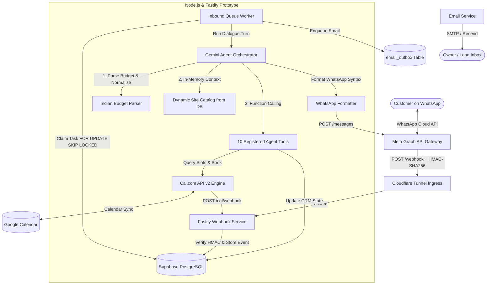

# WhatsApp AI Lead Qualification & Site-Visit Booking Agent

> An automated conversational backend prototype that receives WhatsApp inquiries, qualifies real-estate buyers through structured dialogue, and books on-site inspection visits via Cal.com.

---

## 📌 Project Overview & Prototype Scope

This repository contains an academic and applied software engineering prototype of an automated backend service for local real estate developers and site-visit businesses. 

Built entirely in real, type-safe TypeScript (without low-code/no-code platforms like n8n or Make), the service processes incoming WhatsApp messages, extracts buyer requirements (budget, timeline, intent), queries live booking availability, and confirms calendar appointments.

> **Academic Prototype Notice**: This system is engineered and demonstrated as a **working software prototype**, not a multi-tenant or commercial software-as-a-service deployment. All tests run locally using simulated database drivers or local mock servers.

---

## ✨ Key Features

- **Official Meta WhatsApp Cloud API**: Native Graph API v26.0 integration with cryptographic `X-Hub-Signature-256` HMAC validation and sub-second webhook acknowledgments.
- **Stateful Conversational Debouncing**: Database-driven 3-second aggregation buffer on `inbound_events` to consolidate rapid successive customer texts into a unified LLM turn.
- **Deterministic Indian Budget Normalization**: Custom parsing engine converting colloquial Indian currency terms (`"1core"`, `"1.5 cr"`, `"50-60 lakhs"`, `"under 80L"`, `"karod"`) into verified numeric INR figures (`10,000,000`).
- **Cal.com v2 Scheduling Engine**: Cal.com serves as the single source of truth for calendar availability. Queries live time slots, atomically blocks appointments, prevents duplicate double-bookings, and handles `409 Conflict` race conditions.
- **10 Registered AI Agent Tools**: Gemini utilizes exactly **10 registered function calling tools** for domain operations (see [Registered Agent Tools](#registered-agent-tools)).
- **Dynamic Ground-Truth Property Catalog**: Verified site inventory (plot sizes, dimensions, locations, pricing) is dynamically loaded from Supabase PostgreSQL on each turn, eliminating multi-round-trip tool latency.
- **Multi-Model LLM Auto-Fallback**: Resilient failover mechanism (`gemini-flash-latest` ➔ `gemini-3.5-flash`) that automatically switches models upon detecting free-tier daily quota exhaustion (`RESOURCE_EXHAUSTED`).
- **Asynchronous Email Notification Outbox**: Transactional email dispatcher with HTML entity sanitization (`escapeHtml()`) delivering site visit confirmations, owner summaries, and human-attention alerts without blocking WhatsApp replies.
- **Audio Note Transcription**: Multimodal voice-note support transcribing English, Hindi, and Telugu speech via Gemini.
- **Admin REST Control API**: Protected management endpoints (`/admin/*`) providing health checks, lead inspection, and live Cal.com status.

---

## 🏛️ System Architecture



---

## 🔄 Conversational Message-Flow Pipeline

1. **Webhook Ingress**: When a user texts the WhatsApp Business Number, Meta dispatches a signed webhook payload to `/webhook`.
2. **Signature & Idempotency**: Fastify validates `X-Hub-Signature-256` using constant-time comparison (`crypto.timingSafeEqual`) and idempotently logs the message to `inbound_events`.
3. **Debounce Buffer**: A database-driven 3-second debounce window waits for any immediate follow-up messages from the user before triggering the queue.
4. **Context Assembly**: The orchestrator retrieves:
   - Recent chat history (with transient error cleansing and alternating turn validation).
   - Business configuration and working hours.
   - Dynamic site inventory fetched live from the `sites` database table.
5. **LLM Evaluation**: Google Gemini evaluates the turn. If qualification details are present, it executes function tools:
   - Normalizes budget to INR numeric format.
   - Updates CRM lead classification (`COLD`, `WARM`, `HOT`).
6. **Appointment Booking**: If visit intent is confirmed:
   - Calls `check_availability` to fetch real Cal.com v2 slots.
   - Upon slot confirmation, executes `book_site_visit`.
7. **Outbound Dispatch**: The response is sanitized (Markdown headings stripped, single-asterisk `*bold*` enforced) and dispatched back via Meta Graph API.
8. **Notification**: A structured email alert is asynchronously staged in `email_outbox` and transmitted to the business owner.

---

## 🧰 Registered Agent Tools

The Gemini agent is configured with exactly **10 registered tools**:

| # | Tool Name | Scope & Purpose |
| :-: | :--- | :--- |
| 1 | `search_knowledge` | Queries project FAQs, legal approvals, RERA IDs, and bank loan policies via text search. |
| 2 | `list_sites` | Retrieves inventory of available projects, communities, and commercial layouts. |
| 3 | `get_site_details` | Obtains specific property specs, boundaries, pricing, and master plan data. |
| 4 | `send_site_images` | Dispatches verified site layout photos and renders directly to WhatsApp. |
| 5 | `update_lead` | Persists buyer parameters (budget, timeline, preference, contact details) to the database. |
| 6 | `classify_lead` | Assigns qualification rating (`cold`, `warm`, `hot`) with verifiable justification. |
| 7 | `check_availability`| Queries Cal.com v2 `/v2/slots` for open site-visit appointment windows. |
| 8 | `book_site_visit` | Atomically creates a scheduled appointment in Cal.com and logs visit records. |
| 9 | `reschedule_or_cancel_visit` | Updates or cancels an existing booking in Cal.com with reason tracking. |
| 10 | `handoff_to_human` | Disables automated agent replies and escalates the conversation to human staff. |

*(Note: Ground-truth site specifications such as plot sizes and locations are dynamically loaded from the database into the system prompt on each turn, enabling instantaneous single-turn answers for general inventory queries).*

---

## 💻 Tech Stack

- **Runtime & Language**: Node.js (v20+) with TypeScript (Strict mode enabled).
- **Web Framework**: Fastify v5 (with `fastify-raw-body`, `@fastify/cors`, `@fastify/rate-limit`).
- **Database**: Supabase PostgreSQL with Row Level Security (RLS) and version-controlled SQL migrations.
- **Generative AI**: Google Gemini API via `@google/genai` (Primary: `gemini-flash-latest`, with auto-fallback).
- **Scheduling**: Cal.com API v2 (`cal-api-version: 2024-08-13` for bookings, `2024-09-04` for slots).
- **Communication Channels**: Meta WhatsApp Cloud API (Graph API v26.0).
- **Email Infrastructure**: Nodemailer (SMTP) with HTML entity escaping and Resend support.
- **Testing Framework**: Vitest (61 unit, integration, and replay test suites).

---

## ⚙️ Setup & Installation

### 1. Prerequisites
- Node.js >= 20.0.0
- npm >= 9.0.0
- A Supabase project with PostgreSQL
- A Meta Developer Account with WhatsApp Cloud API enabled
- A Cal.com account (with API v2 key and an active event type)

### 2. Environment Variables Configuration
Copy `.env.example` to `.env`:
```bash
cp .env.example .env
```
Fill in the following required environment variable names (do not commit this file):

- **Server**: `PORT`, `HOST`, `NODE_ENV`, `PUBLIC_BASE_URL`
- **Database**: `SUPABASE_URL`, `SUPABASE_SERVICE_ROLE_KEY`, `SUPABASE_ANON_KEY`
- **Meta WhatsApp**: `WHATSAPP_PHONE_NUMBER_ID`, `WHATSAPP_BUSINESS_ACCOUNT_ID`, `WHATSAPP_ACCESS_TOKEN`, `WHATSAPP_APP_SECRET`, `WHATSAPP_VERIFY_TOKEN`, `WHATSAPP_API_VERSION`
- **Google AI**: `GEMINI_API_KEY`, `GEMINI_MODEL`
- **Admin Security**: `ADMIN_API_KEY`
- **Business**: `BUSINESS_TIMEZONE`, `NOTIFY_EMAIL`
- **Cal.com**: `CAL_API_KEY`, `CAL_API_VERSION`, `CAL_SLOTS_API_VERSION`, `CAL_DEFAULT_EVENT_TYPE_ID`, `CAL_WEBHOOK_SECRET`, `CAL_FALLBACK_ATTENDEE_EMAIL`
- **Email Outbox**: `EMAIL_PROVIDER` (`mock` for local tests), `SMTP_HOST`, `SMTP_PORT`, `SMTP_USER`, `SMTP_PASS`, `EMAIL_FROM`

### 3. Apply Database Migrations
Execute the SQL files in your Supabase SQL Editor in order:
1. `supabase/migrations/20241017000000_init_schema.sql` (Core tables, RLS policies, indexes)
2. `supabase/migrations/20261017000001_agent_revisions.sql` (Cal v2 tracking, idempotency tables)
3. `supabase/seed.sql` (Fictional real-estate catalog & baseline FAQ knowledge base)

### 4. Build and Run Server
```bash
npm install
npm run build
npm start
```
The server will bind to `http://localhost:3000`.

### 5. Expose Webhook via Cloudflare Tunnel
For local prototype testing, expose port 3000:
```bash
cloudflared tunnel --url http://localhost:3000
```
Copy the generated URL (e.g., `https://xxxx.trycloudflare.com`) and set it as `PUBLIC_BASE_URL` in `.env`.

### 6. Meta Developer & Cal.com Webhook Setup
- **Meta WhatsApp Webhook**:
  - Callback URL: `https://xxxx.trycloudflare.com/webhook`
  - Verify Token: Match `WHATSAPP_VERIFY_TOKEN` in `.env`
  - Webhook fields: Subscribe to `messages`.
- **Cal.com Webhook**:
  - Subscriber URL: `https://xxxx.trycloudflare.com/cal/webhook`
  - Secret: Match `CAL_WEBHOOK_SECRET` in `.env`
  - Events: Subscribe to `BOOKING_CREATED`, `BOOKING_RESCHEDULED`, `BOOKING_CANCELLED`.

---

## 🧪 Testing & Verification

### Running Automated Test Suites
Run all 61 automated test suites:
```bash
npm test
```

Run TypeScript compilation verification:
```bash
npm run typecheck
```

Build production distribution:
```bash
npm run build
```

---

## 🔍 Mocked in Tests vs. Verified Manually

To maintain academic transparency, the verification status of components is explicitly distinguished:

| Component | In Automated Test Suite (`npm test`) | Verified Manually in Working Prototype |
| :--- | :---: | :---: |
| **Budget Normalization Engine** | ✅ Unit tests on all Indian colloquial budget formats | ✅ Verified in live chat |
| **WhatsApp Markdown Formatter** | ✅ Unit tests verifying single asterisk & bullets | ✅ Verified on mobile screen |
| **HMAC-SHA256 Signature Verification** | ✅ Unit tests with authentic & tampered payloads | ✅ Verified against Meta & Cal webhooks |
| **Prompt Injection Protection** | ✅ Unit tests with persona-hijacking payloads | ✅ Verified via simulation |
| **Meta Graph API Network Calls** | 🟡 Mocked via HTTP spies & fixtures | ✅ Verified live via Meta Cloud API |
| **Google Gemini API Network Calls** | 🟡 Mocked via deterministic response fixtures | ✅ Verified live via `@google/genai` |
| **Cal.com Slot Queries & Bookings** | 🟡 Mocked via API contract fixtures | ✅ Verified live on Cal.com v2 |
| **Database Concurrency & Double-Booking** | ✅ Unit tests simulating atomic race conditions | ✅ Verified against Supabase PostgreSQL |
| **Email Dispatcher** | ✅ Unit tests in `mock` provider mode | ✅ Verified via mock delivery logger |

---

## ⚠️ Prototype Limitations

1. **Local Prototype Hosting**: When hosted on a developer workstation using temporary tunnels (Cloudflare / ngrok), the agent is offline whenever the workstation sleeps or disconnects.
2. **Free-Tier LLM Quotas**: Tested under free-tier Google Gemini rate limits (e.g., 20 requests/day on preview tiers). While auto-fallback is implemented, commercial deployments require an enterprise tier.
3. **Single-Instance Queue Worker**: Inbound message debouncing and processing use an in-process worker loop. Scaling across horizontal nodes requires a distributed worker (e.g. BullMQ / Redis).
4. **No Full Human Inbox UI**: Human handoff mutes the AI agent, but human replies must currently be sent via the Meta Business WhatsApp inbox or Supabase dashboard.
5. **Simulated Catalog Data**: The database seed contains fictional property data (**Emerald Meadows Villa Plots**, **Skyline Sovereign Villas**) for evaluation purposes.

---

## 🔮 Future Work

- [ ] **Interactive WhatsApp Buttons**: Support for interactive Quick Reply buttons and WhatsApp Carousel templates.
- [ ] **Dedicated Admin Dashboard**: A frontend web dashboard (Next.js / Vite) for sales managers to view lead timelines and take over chats live.
- [ ] **Multi-Agent Architecture**: Separate specialized sub-agents for financial pre-qualification and technical document compliance.
- [ ] **Voice Generation (TTS)**: Interactive audio return notes synthesized via ElevenLabs or Gemini Multimodal Live.

---

## 👥 Author & Academic Attribution

- **Student / Project Lead**: *[Your Name Here]*
- **Course / Degree**: *[Your College / Department / Degree]*
- **Institution**: *[Your University / College Name]*
- **Academic Year**: 2025–2026

---

## 📄 License

This project is licensed under the [MIT License](file:///e:/Ai%20Automation%20Agent/LICENSE).
