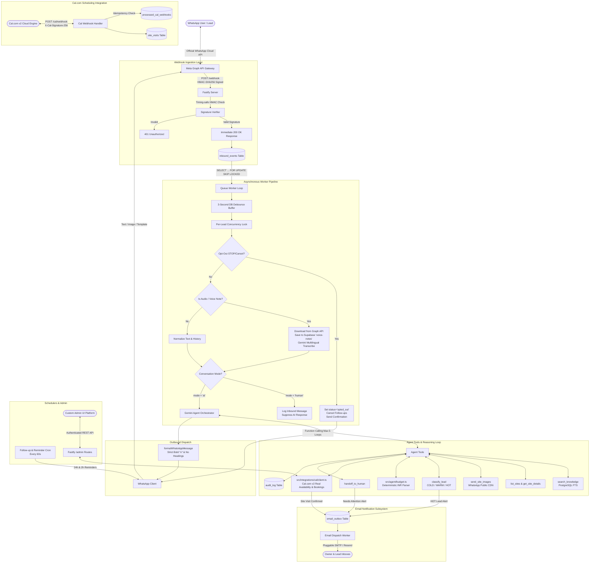

# System Architecture: WhatsApp AI Lead Qualification & Site-Visit Booking Agent

This document details the architectural design, asynchronous processing pipeline, concurrency controls, Cal.com scheduling integration, email notification subsystem, and conversational state machine powering the WhatsApp AI Agent for local real estate businesses.

---

## 1. High-Level System Architecture

---

## 2. Ingestion & Asynchronous Queue Pipeline

Meta's Cloud API requires webhooks to return a `200 OK` response within 3 seconds; otherwise, Meta will continuously retry, causing duplicate processing.

1. **HMAC-SHA256 Signature Verification**:
   - The raw byte buffer (`request.rawBody`) is captured before JSON parsing.
   - The `x-hub-signature-256` header is computed with `crypto.timingSafeEqual` to avoid timing attacks.
2. **Sub-Second Enqueue**:
   - Inbound messages are inserted into the `inbound_events` table with `ON CONFLICT (wa_message_id) DO NOTHING`.
   - The HTTP response returns `200 OK` in less than 50 milliseconds.
3. **Database-Level Debounce**:
   - Customers often send multiple short messages in succession (e.g. "Hi", "Are plots available?", "In Shamshabad").
   - The stored procedure `claim_inbound_events()` uses `HAVING MAX(created_at) <= NOW() - INTERVAL '3 seconds'` so that a customer's turn is only claimed once they pause typing for 3 seconds, bundling them into a single coherent prompt turn.

---

## 3. Cal.com v2 Scheduling Integration

Cal.com serves as the single source of truth for all site visit bookings:

- **Live Slot Availability**: Calls `GET https://api.cal.com/v2/slots?eventTypeId=...&startTime=...&endTime=...` with header `cal-api-version: 2024-09-04`. Results are formatted into `Asia/Kolkata` time and cached in memory for 60 seconds.
- **Booking Creation**: Calls `POST https://api.cal.com/v2/bookings` with header `cal-api-version: 2024-08-13`. Automatically associates lead metadata (`lead_id`, `wa_id`, `site_id`, `source: whatsapp-agent`).
- **Cancellation & Rescheduling**: Uses `POST /v2/bookings/{uid}/cancel` and `POST /v2/bookings/{uid}/reschedule`.
- **Webhook Handshake & Idempotency**: `POST /cal/webhook` verifies the `X-Cal-Signature-256` HMAC header with `CAL_WEBHOOK_SECRET` and de-duplicates events using the `processed_cal_webhooks` table.

---

## 4. Email Notification Outbox Architecture

To ensure that email delivery issues never slow down or block instant WhatsApp replies:

1. **Asynchronous Outbox**: Emails are queued into the `email_outbox` table with HTML and plain-text versions.
2. **HTML Injection Protection**: All customer-supplied text (names, notes, inquiries) is strictly escaped via `escapeHtml()`.
3. **Retry & Backoff**: A dedicated email worker delivers pending emails via SMTP (Nodemailer) or Resend, with up to 5 retries.
4. **Triggered Notifications**:
   - **Site Visit Confirmed**: Summary sent to `NOTIFY_EMAIL` (`admin@example.com`) with lead name, WhatsApp number, site, date/time in IST, score, budget, timeline, purpose, summary, pickup request, and Cal reschedule/cancel links. A copy is sent to the lead if email was provided.
   - **HOT Lead Alert**: Instant alert when lead is classified as HOT.
   - **Needs Attention Alert**: Triggered on human handoff or technical booking failures.
   - **Booking Status Change**: Sent whenever a visit is cancelled or rescheduled.

---

## 5. Resilient AI Turn Loop & Fallbacks

- **Deterministic Numeric Budgeting**: `src/agent/budget.ts` parses expressions like `1core`, `50-60 lakhs`, `under 80L`, `1.5 cr` into clean INR integers (`10,000,000`), protecting against LLM arithmetic hallucinations.
- **Tool Error Catching**: Tool errors never abort a turn. All tool exceptions return `{ error: message }` to Gemini so the model can recover and reply.
- **Exponential Backoff**: Up to 2 retries with backoff on Gemini 429 rate-limits or 5xx server errors.
- **Per-Turn Hard Timeout**: 25-second timeout enforced via `Promise.race`.
- **Honest Fallback**: If Gemini fails after retries, sends an honest message: *"Sorry, I hit a small technical issue. Could you send that again in a minute?"* Rate-limited to at most one fallback per lead per 10 minutes.
