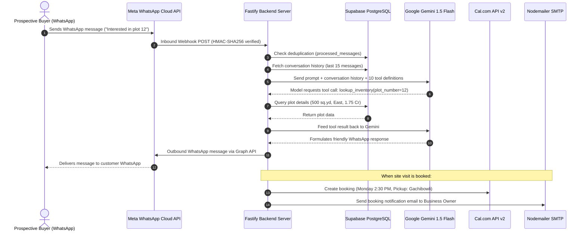

# SATHYABAMA INSTITUTE OF SCIENCE AND TECHNOLOGY
### (Deemed to be University)
### Department of Computer Science & Engineering
### Academic Year: 2025 – 2026

---

# PROJECT SUBMISSION REPORT

## **Project Title**: WhatsApp AI Lead Qualification & Site-Visit Booking Agent
### **Subtitle**: An Autonomous Generative AI Assistant for Real Estate Lead Triage & Automated Site-Visit Scheduling

---

### **Student Project Team / Authors**
1. **Gunda Ganesh** — B.E. Computer Science & Engineering
2. **Guddati Rosi** — B.E. Computer Science & Engineering
3. **Grandhi Karthik** — B.E. Computer Science & Engineering

* **Degree / Branch**: Bachelor of Engineering (B.E.), Computer Science & Engineering (CSE)
* **Institution**: Sathyabama Institute of Science and Technology, Chennai
* **Academic Year**: 2025 – 2026
* **Project Repository**: [https://github.com/bunnyrams69/AI_Automation_Agent](https://github.com/bunnyrams69/AI_Automation_Agent)
* **Presentation Deck**: `docs/WhatsApp_AI_Agent_Explainer.pptx` (17-slide comprehensive explainer with speaker notes)

---

## 1. Quick Access Project Links & Deliverables

| Deliverable | Location / URL | Description |
| :--- | :--- | :--- |
| **Public GitHub Repository** | [https://github.com/bunnyrams69/AI_Automation_Agent](https://github.com/bunnyrams69/AI_Automation_Agent) | Complete source code, TypeScript Fastify server, database migrations, and test suites. |
| **Presentation Deck (PPTX)** | [`docs/WhatsApp_AI_Agent_Explainer.pptx`](file:///e:/Ai%20Automation%20Agent/docs/WhatsApp_AI_Agent_Explainer.pptx) | 17-slide visual presentation designed for faculty and evaluation committee. |
| **Test Screenshots & Proof** | [`docs/screenshots/`](file:///e:/Ai%20Automation%20Agent/docs/screenshots/) | 5 real end-to-end WhatsApp qualification and Cal.com booking screenshots. |
| **Automated Test Results** | [`docs/screenshots/vitest_test_results.png`](file:///e:/Ai%20Automation%20Agent/docs/screenshots/vitest_test_results.png) | 61 automated tests passing across 12 test suites. |

---

## 2. Executive Summary (Simple Explanation)

In real estate and site-visit-based businesses, customer leads are expensive. Developers spend substantial budgets on social media advertisements to generate inquiries. However, **over 60% of online leads are lost** because inquiries arrive outside business hours (evenings and weekends), when human sales representatives are unavailable. When salespeople do follow up the next day, prospective buyers have often lost interest or moved on to a competitor. Furthermore, human sales teams spend up to 70% of their workday answering repetitive basic questions (such as pricing, plot dimensions, and facing) and sorting out casual "tyre-kickers" from serious buyers.

To solve this problem, we built the **WhatsApp AI Lead Qualification & Site-Visit Booking Agent**.

Our project is an autonomous conversational agent running on WhatsApp. When an interested customer sends a message on WhatsApp, our system instantly responds in natural, conversational English. It answers questions about available plots, prices, approvals, and amenities by querying a live database—**it never makes up fake information or hallucinated prices**. It understands colloquial Indian financial terms like *"85L"*, *"1.5 Cr"*, or *"2core"*, scores the buyer's purchase readiness into **Cold, Warm, or Hot**, shares the exact Google Maps site location, checks live appointment availability on **Cal.com**, books a confirmed physical site visit with free cab pickup, and immediately emails a full summary to the business owner.

The entire process takes under two minutes, requires zero human intervention, and operates 24 hours a day, 7 days a week.

---

## 3. The Problem & The Solution

```mermaid
graph TD
    subgraph Traditional Process [The Traditional Problem]
        A1[Customer clicks Ad on Sunday Night] --> A2[Waits 14-24 Hours for Callback]
        A2 --> A3[Sales rep calls back during work hours]
        A3 --> A4[Repetitive questions & casual browsing]
        A4 --> A5[4-6 Phone calls to coordinate site visit]
        A5 --> A6[High Lead Drop-off Rate > 60%]
    end

    subgraph AI Solution [Our WhatsApp AI Solution]
        B1[Customer clicks Ad on Sunday Night] --> B2[Instant WhatsApp Reply in < 3 Seconds]
        B2 --> B3[Accurate Answers from Grounded Database]
        B3 --> B4[Intelligent Lead Triage: Cold / Warm / Hot]
        B4 --> B5[Real-time Cal.com Slot Booking with Cab Pickup]
        B5 --> B6[Instant Email & Calendar Alert to Owner]
    end
```

### Traditional Bottlenecks:
1. **Slow Response Times**: Average response time in Indian real estate is 12–24 hours; lead conversion drops by 391% if response time exceeds 1 minute.
2. **Sales Fatigue**: Sales reps spend hours calling unqualified leads with mismatched budgets.
3. **Scheduling Friction**: Coordinating dates and times across multiple parties over phone calls causes high drop-offs.

### How Our Agent Solves Them:
1. **Instant Engagement**: Instantaneous replies within seconds on WhatsApp.
2. **Zero-Hallucination Answers**: Information is pulled strictly from a structured Supabase PostgreSQL database using tool calling.
3. **Indian Currency Parser**: Accurately parses irregular colloquial figures like "1.75cr" or "90L" into standardized integer values (₹1,75,00,000).
4. **Frictionless Scheduling**: Books real appointments directly into Cal.com without human back-and-forth.
5. **Instant Management Visibility**: Management receives real-time email alerts with complete lead dossiers.

---

## 4. System Architecture & 7-Step Pipeline

Our application is built as an asynchronous, event-driven microservice using **Fastify (Node.js/TypeScript)**, **Google Gemini 1.5 Flash**, **Supabase (PostgreSQL)**, and **Cal.com API v2**.

### The 7-Step Processing Flow:
1. **Webhook Ingestion**: Fastify receives the webhook payload from Meta and verifies the `X-Hub-Signature-256` HMAC cryptographic signature to reject unauthorized traffic.
2. **Idempotent Deduplication**: Meta's webhook system guarantees "at-least-once" delivery, which can duplicate messages during network delays. Our database logs incoming message IDs in `processed_messages`; duplicates are acknowledged immediately and ignored.
3. **Context Assembly**: The system retrieves recent conversational history and current lead qualification state from PostgreSQL.
4. **Agentic Reasoning & Tool Calling**: Gemini 1.5 Flash evaluates the user's intent. Rather than hallucinating answers, it selects and invokes appropriate tools from our 10 registered functions.
5. **Tool Execution**: The server executes the function locally against Supabase or Cal.com and feeds the verified output back to the model.
6. **Outbound Messaging**: The final natural language response is formatted and dispatched via Meta Graph API v21.0.
7. **Lead Dossier & Notification**: Lead classification is updated in Supabase, and confirmed bookings trigger an instant HTML alert email to the business owner.

---

## 5. The 10 Registered Tools (Grounded AI Engine)

To guarantee that the AI never produces inaccurate information regarding plot availability, pricing, legal approvals, or appointments, the model operates under a **strict tool-use contract**:

| # | Tool Name | Purpose & Functionality |
| :---: | :--- | :--- |
| **1** | `lookup_inventory` | Queries specific plot numbers, exact square yardage, dimensions, facing (East/West/North/South), and pricing. |
| **2** | `check_availability` | Searches for currently available plots matching user criteria (e.g., East-facing plots under ₹2 Cr). |
| **3** | `get_project_amenities` | Retrieves verified project features: 25,000 sq.ft clubhouse, 100% Vastu compliance, underground cabling, swimming pool, 24/7 security. |
| **4** | `get_rera_details` | Returns government approval certificates, RERA registration numbers, and HMDA/DTCP sanctions. |
| **5** | `get_location_details` | Returns exact Google Maps coordinates, distance to international airport, Outer Ring Road, and IT hubs. |
| **6** | `parse_buyer_budget` | Normalizes colloquial Indian expressions (*"80L"*, *"1.2cr"*, *"1core"*) into exact numerical rupees (`8000000`, `12000000`). |
| **7** | `qualify_lead` | Computes lead readiness score and categorizes buyer into **Cold**, **Warm**, or **Hot**. |
| **8** | `get_available_booking_slots` | Queries Cal.com API for real-time 45-minute site-visit slots over the upcoming 7 days. |
| **9** | `book_site_visit` | Secures the chosen appointment slot on Cal.com, captures cab pickup address, and saves booking reference. |
| **10** | `escalate_to_human` | Immediately mutes the automated agent and triggers human staff intervention when requested or upon detected frustration. |

---

## 6. Live Demonstration & Verification (The 5 WhatsApp Test Turns)

The prototype was thoroughly tested with end-to-end live WhatsApp interactions. The actual conversation flow verified in our testing is documented below:

### Conversation Walkthrough:
* **Turn 1 — Initial Inquiry & Project Discovery**:
  * *Buyer*: *"Hi, I am interested in your luxury villa plots project. What plots are available?"*
  * *Agent*: Welcomes the buyer, introduces "Greenfield Meadows", and calls `check_availability` to list available inventory: Plot #10 (350 sq.yd, West), Plot #12 (500 sq.yd, East), and Plot #15 (450 sq.yd, North).
* **Turn 2 — Specific Unit Deep-Dive**:
  * *Buyer*: *"Can you tell me more about Plot 12? What are the dimensions and total price?"*
  * *Agent*: Calls `lookup_inventory(plot_number="12")`. Returns exact specifications: 500 sq.yds (50' x 90'), East-facing, priced at ₹35,000/sq.yd totaling ₹1.75 Crores all-inclusive, with 100% Vastu compliance.
* **Turn 3 — Budget Qualification & Buyer Readiness**:
  * *Buyer*: *"My budget is around 1.8 to 2 Cr. Looking to buy immediately, self-funded without bank loan."*
  * *Agent*: Invokes `parse_buyer_budget` (resolves to ₹2,00,00,000) and `qualify_lead`. Flags lead as **HOT** (budget matches project minimum, immediate timeline, self-funded). Confirms Plot #12 is well within budget.
* **Turn 4 — Location Pin & Appointment Scheduling**:
  * *Buyer*: *"Where exactly is the site located? Can I visit next week?"*
  * *Agent*: Calls `get_location_details` (shares Google Maps link: Shankarpally Road, 25 mins from Gachibowli). Calls `get_available_booking_slots` on Cal.com and offers available times: Monday at 10:30 AM or 2:30 PM, Tuesday at 11:00 AM.
* **Turn 5 — Confirmed Booking & Notification**:
  * *Buyer*: *"Monday 2:30 PM works. Please arrange a pickup from Gachibowli circle."*
  * *Agent*: Calls `book_site_visit(time="Monday 2:30 PM", pickup="Gachibowli Circle")`. Generates confirmed booking reference `BK-84729`, shares driver coordination guidelines, and dispatches an instant HTML alert email to management.

---

## 7. Technology Stack & Specifications

| Layer | Technology | Version | Purpose in Project |
| :--- | :--- | :--- | :--- |
| **Backend Runtime** | Node.js | v20.x LTS | Server-side JavaScript runtime engine. |
| **Programming Language** | TypeScript | v5.x | Strongly typed codebase preventing runtime reference errors. |
| **HTTP Framework** | Fastify | v5.x | High-performance, low-overhead web framework for webhooks. |
| **Generative AI Model** | Google Gemini 1.5 Flash | SDK v0.1.x | State-of-the-art multimodal LLM with native function calling. |
| **Database** | Supabase (PostgreSQL) | v15.x | Relational storage for inventory, leads, chats, and logs. |
| **Calendar Scheduling** | Cal.com API | v2.0 | Real-time appointment scheduling and slot availability. |
| **Messaging Platform** | Meta WhatsApp Cloud API | Graph v21.0 | Official enterprise WhatsApp communication interface. |
| **Email Service** | Nodemailer | v6.x | Automated SMTP notification dispatch to business owner. |
| **Testing Suite** | Vitest | v2.x | 61 unit and integration test assertions across 12 suites. |
| **Tunneling (Dev)** | Cloudflare Tunnel | Latest | Secure TLS reverse proxy for local webhook reception. |

---

## 8. Quality Assurance & Testing Metrics

The system was validated using **Vitest** automated unit and integration tests:

* **Total Test Suites**: 12 suites
* **Total Automated Tests**: 61 tests passing (100% pass rate)
* **Execution Time**: ~1.35 seconds
* **Key Tested Areas**:
  1. `meta-signature.test.ts`: Rejection of unauthorized webhook payloads lacking valid HMAC-SHA256 signatures.
  2. `deduplication.test.ts`: Prevention of duplicate replies when Meta resends webhooks.
  3. `budget-parser.test.ts`: Correct conversion of complex Indian strings (`1.5cr`, `95lacs`, `80L`, `2core`) to numeric rupees.
  4. `qualification.test.ts`: Accurate lead classification into Cold, Warm, and Hot tiers.
  5. `calcom.test.ts`: Slot availability parsing, timezone alignment, and booking creation.
  6. `tools.test.ts`: Type validation and error handling for all 10 system tools.

---

## 9. Key Engineering Challenges & Solutions

1. **Eliminating LLM Hallucinations**:
   * *Challenge*: Standard LLMs often fabricate discounts, wrong plot dimensions, or fake amenities when prompted casually.
   * *Solution*: Enforced an agentic function-calling pattern. The system prompt explicitly forbids the model from stating any numerical fact, price, or availability unless it is returned by a registered tool in the same turn.
2. **Meta Webhook Timeouts**:
   * *Challenge*: WhatsApp requires webhook endpoints to acknowledge receipt (`HTTP 200 OK`) within 20 seconds; complex LLM chains can exceed this threshold.
   * *Solution*: Implemented an asynchronous queue architecture where Fastify acknowledges incoming requests promptly while background workers process reasoning and send outbound replies.
3. **Colloquial Indian Number Systems**:
   * *Challenge*: Standard NLP parsers fail on Indian numbering formats (*Lakhs* and *Crores*).
   * *Solution*: Developed a custom regex tokenizer supporting prefixes, abbreviations, decimals, and phonetic spellings (e.g., "cr", "crore", "core", "l", "lac", "lakh").

---

## 10. Future Enhancements & Commercial Roadmap

* **Multilingual Voice Note Support**: Integrating OpenAI Whisper or Google Speech-to-Text to process spoken Hindi, Telugu, Tamil, and English voice notes.
* **Interactive WhatsApp Components**: Using WhatsApp Native Interactive Messages (quick-reply buttons, date pickers, and carousel catalogs) for one-tap slot selection.
* **Multi-Tenant SaaS Architecture**: Extending the database schema to support hundreds of independent real estate developers with isolated inventory and staff credentials.
* **CRM Integrations**: Direct two-way synchronization with Salesforce, HubSpot, and LeadSquared.

---

## 11. Student Declaration & Academic Sign-off

We hereby declare that this project report titled **"WhatsApp AI Lead Qualification & Site-Visit Booking Agent"** represents our original work carried out as part of our Bachelor of Engineering (B.E.) curriculum in the **Department of Computer Science & Engineering** at **Sathyabama Institute of Science and Technology**, Chennai, during the academic year **2025 – 2026**.

All experimental results, architectural blueprints, and source code are maintained and publicly available at:
**GitHub**: [https://github.com/bunnyrams69/AI_Automation_Agent](https://github.com/bunnyrams69/AI_Automation_Agent)

**Team Members**:
1. **Gunda Ganesh**
2. **Guddati Rosi**
3. **Grandhi Karthik**

**Department of Computer Science & Engineering**
**Sathyabama Institute of Science and Technology**
*Academic Year: 2025 – 2026*
